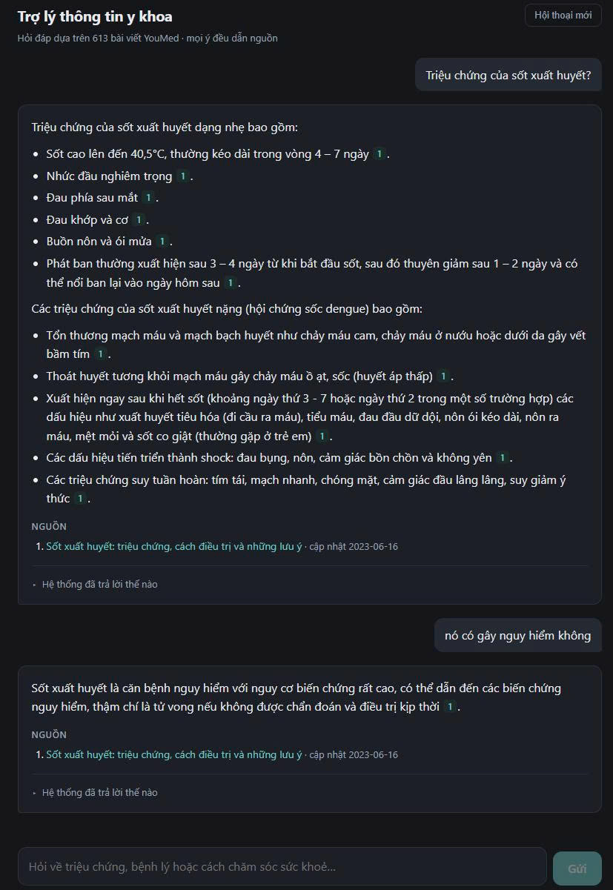

# Medical Agentic RAG

Hệ thống hỏi đáp y khoa tiếng Việt dựa trên 613 bài viết YouMed, điều phối bằng LangGraph. Mọi câu
trả lời đều dẫn nguồn và được kiểm tra trích dẫn trước khi trả về.

**[Xem demo](https://hhieu21-medrag.onrender.com)** · lần mở đầu cần khoảng một phút để khởi động



## Tính năng

- **Routing theo loại câu hỏi:** 6 route (định nghĩa, hỏi một khía cạnh của bệnh, triệu chứng,
  so sánh, nhiều khía cạnh, câu hỏi phức tạp), mỗi route một chiến lược truy xuất riêng.
- **Hybrid retrieval tiếng Việt:** dense (EmbeddingGemma) + sparse tự xây (âm tiết, bigram, bản
  không dấu), gộp bằng RRF trong Qdrant, rerank bằng cross-encoder.
- **Tự sửa truy vấn:** chấm từng nguồn, tính độ phủ khía cạnh, truy xuất bổ sung hoặc viết lại truy
  vấn (tối đa 2 lần).
- **Research agent** với 6 tool nội bộ và ngân sách cứng (tối đa 6 lời gọi tool).
- **An toàn hai tầng:** rule + LLM; ca cấp cứu / tự hại trả về template cố định, không qua LLM.
- **Kiểm tra trích dẫn:** loại câu không được nguồn hỗ trợ, viết lại khi bị loại quá nhiều.
- **Hội thoại nhiều lượt** và **streaming** từng bước xử lý qua SSE.

## Kết quả

Split `test` của bộ dữ liệu tự xây (88 câu: 50 văn nói, 14 ngoài phạm vi, 24 an toàn), khoảng tin
cậy Wilson 95%.

| Hạng mục | Kết quả |
|---|---|
| Tìm đúng bài (Article@5) | 0.94 [0.84–0.98] |
| Nêu đủ ý chính | 0.73 [0.60–0.84] |
| Câu y khoa có trích dẫn | 0.97 [0.94–0.99] |
| Trích dẫn đúng nguồn\* | 0.92 [0.87–0.95] |
| Từ chối nhầm ↓ | 0.08 [0.03–0.19] |
| Nói "chưa có thông tin" đúng lúc | 1.00 [0.78–1.00] |
| Bắt ca cấp cứu / tự hại | 1.00 [0.72–1.00] |
| Dừng nhầm ↓ | 0.21 [0.08–0.48] |

Routing accuracy 0.858 (106 câu) · Retrieval Article@5 0.92 (hybrid + rerank, 234 câu) · 123 unit test

\* LLM-as-judge, chưa hiệu chuẩn bằng người.

## Kiến trúc

```
React (Render Static Site)
   │  SSE
   ▼
FastAPI + LangGraph (Render) ──┬──► Qdrant Cloud           dense + sparse, RRF
                               ├──► Hugging Face ZeroGPU   embed + rerank
                               ├──► LLM                    gemini-2.5-flash
                               └──► SQLite checkpointer    hội thoại nhiều lượt
```

| Thành phần | Công nghệ |
|---|---|
| Điều phối | LangGraph |
| API | FastAPI, SSE |
| Frontend | React, Vite |
| Vector DB | Qdrant (dense + sparse, RRF) |
| Embedding | `google/embeddinggemma-300m` (768 chiều) |
| Rerank | `BAAI/bge-reranker-v2-m3` |
| LLM | `gemini-2.5-flash` |

Khi chạy local, embed + rerank chạy trên GPU qua `model_server/`, Qdrant chạy bằng Docker.

## Pipeline

```
câu hỏi
 ├─ safety_rules ─────────────── cấp cứu / tự hại ──► template cố định
 ├─ condense_question            (bỏ qua ở lượt đầu)
 ├─ analyze_query ────────────── ngoài phạm vi ─────► template
 ├─ route
 │    definition, section_lookup,
 │    symptom_to_condition, comparison ──► hybrid ─► rerank
 │    multi_aspect ──────────────────────► subquery song song ─► merge
 │    complex ───────────────────────────► research agent ─► rerank
 ├─ grade_evidence ───────────── thiếu bằng chứng ──► targeted_retrieve / rewrite_query (≤ 2)
 ├─ generate_answer
 └─ citation_validator ───────── loại quá nhiều câu ► generate lại (≤ 1)
```

| Nhãn an toàn | Hành vi |
|---|---|
| `emergency`, `self_harm` | Dừng pipeline, trả template cố định |
| `high_risk` | Trả lời, chèn khuyến cáo đi khám sớm |
| `medication_dosing` | Không đưa liều cá nhân, lọc câu chứa liều |
| `diagnosis_request` | Nêu khả năng theo tài liệu, không kết luận |

## Chạy local

Yêu cầu: Python 3.12, Docker, Node 16+, GPU (hoặc CPU, chậm hơn).

```bash
cp .env.example .env                                        # điền SHOPAIKEY_API_KEY, LLM_MODEL_*
pip install -r requirements.txt -r model_server/requirements.txt

docker compose up -d                                        # Qdrant :6333
python -m uvicorn model_server.server:app --port 8001       # embed + rerank
python serve.py                                             # API :8000
cd frontend && npm install && npm run dev                   # UI :5173
```

Dựng dữ liệu từ đầu:

```bash
python -m crawler.discover && python -m crawler.fetch && python -m crawler.parse
python -m ingestion.chunk && python -m ingestion.ingest
```

Hỏi qua CLI: `python ask.py "Bệnh Addison là gì?"`

## Đánh giá

```bash
python -m eval.build_testset r        # dựng bộ test
python -m eval.run_eval               # bảng điểm, split test
python -m eval.run_eval --retrieval   # chỉ đo retrieval
python -m eval.run_routing_accuracy   # routing accuracy + confusion matrix
pytest backend/tests -q               # unit test, không cần network
```

Kết quả cache theo từng câu; `--report-only` dựng lại bảng mà không gọi LLM. Chi tiết: `eval/README.md`.

## Deploy

| Thành phần | Nền tảng |
|---|---|
| Frontend | Render Static Site |
| Backend | Render Web Service (`requirements-api.txt`, không torch) |
| Embed + rerank | Hugging Face ZeroGPU Space (`deploy/hf_models_space/`) |
| Vector DB | Qdrant Cloud |
| Keep-alive | GitHub Actions, hằng ngày (`.github/workflows/keepalive.yml`) |

1. Tạo Space từ `deploy/hf_models_space/` với phần cứng ZeroGPU và secret `HF_TOKEN`.
2. Chép collection lên Qdrant Cloud: `python -m deploy.migrate_qdrant`.
3. Render → New → Blueprint, chọn repo (`render.yaml`), điền các secret.
4. Thêm secret `QDRANT_URL`, `QDRANT_API_KEY`, `HF_TOKEN` cho GitHub Actions.

Bản demo giới hạn 10 câu/giờ mỗi IP và 100 câu/ngày.

## Cấu trúc

```
crawler/        discover → fetch → parse ra Markdown + frontmatter
ingestion/      chunk theo H2/H3, sparse tiếng Việt, ingest vào Qdrant, client embed/rerank
model_server/   server embed + rerank chạy local (GPU)
backend/src/medical_agentic_rag/
  api/          FastAPI, SSE, rate limit
  graph/        StateGraph, routing, các node
  retrieval/    hybrid, rerank, khớp tên bài
  agent/        research agent + tool
  safety/       rule, từ khoá, template
  citation/     kiểm tra trích dẫn
  llm/          client, task, prompt, schema
frontend/       React + Vite
eval/           bộ test, bảng điểm, thí nghiệm
deploy/         ZeroGPU Space, script chép Qdrant lên cloud
```

## Lưu ý

Thông tin chỉ mang tính tham khảo, không thay thế chẩn đoán hay chỉ định của bác sĩ. Nội dung bài
viết YouMed không được phân phối lại trong repo này.
